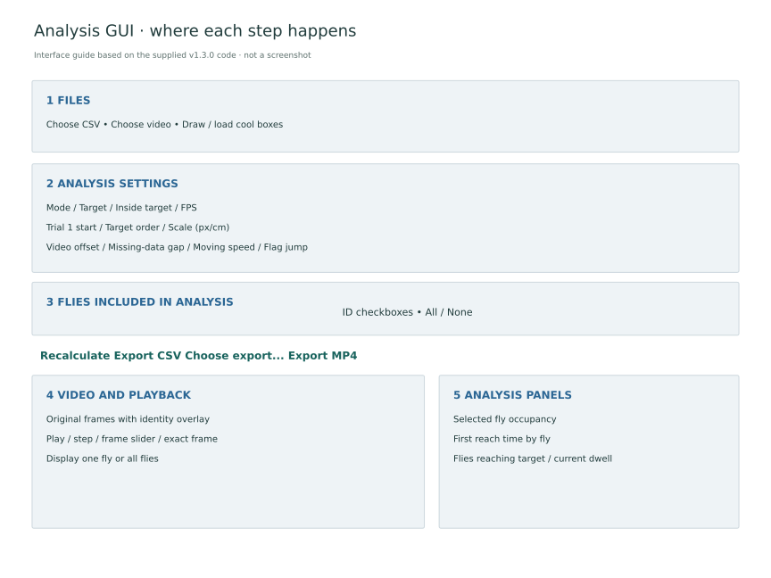
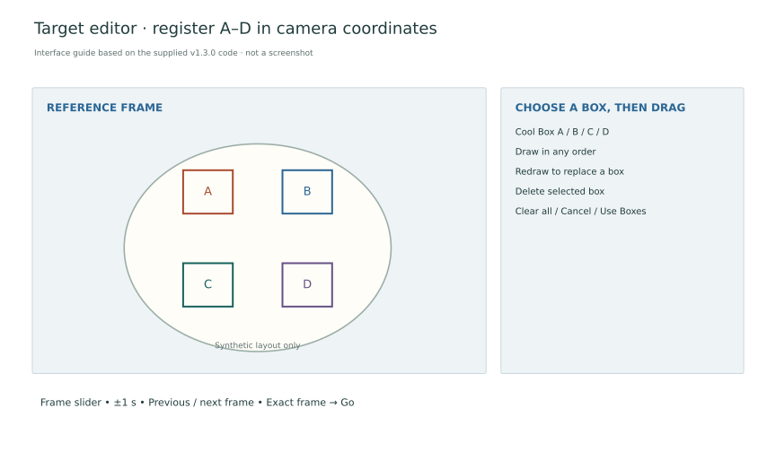

The arena GUI combines video playback, four target regions and the reviewed AMADEUS tracks in one window. It runs locally and calculates measurements from the supplied coordinates.

## 1 · Install and launch

[Download fly_target_time_gui_amadeus.py](../downloads/analysis/fly_target_time_gui_amadeus.py). Use Python 3.10 or later with Tkinter. In PowerShell, open the folder containing the file and run:

```powershell
py -m pip install numpy opencv-python pillow
py fly_target_time_gui_amadeus.py
```

The download is the supplied **version 1.3.0**, unchanged. Its built-in numerical checks can be run without opening a window:

```powershell
py fly_target_time_gui_amadeus.py --self-test
```

## 2 · Load the tracks and video

Choose the reviewed AMADEUS CSV, then the matching video. The CSV contains coordinates in pixels, not centimetres. Check that the displayed markers follow the same flies in the video before calculating results.



*Interface guide based on the supplied code, not a screenshot. The groups correspond to the controls in the application.*

## 3 · Register the four targets

Open **Draw / load**. Select A, B, C or D, then drag a rectangle over that tile. Boxes can be drawn in any order, replaced or deleted individually. Browse the video using the frame slider or exact-frame control to find a clear reference image. The boxes remain fixed in the original image coordinates while frames change.

Use the pre-experiment mask to identify tile positions. Confirm the labels against the physical target controller, then choose **Use Boxes** and save the box JSON. All four regions are required and overlapping regions are rejected.



*Target-editor guide with a synthetic arena layout. These positions illustrate the controls, not the physical target coordinates.*

## 4 · Set time, scale and trials

| Control | Meaning |
| --- | --- |
| Mode | One clip/trial, or the full ten-trial experiment |
| Trial 1 start (CSV) | Zero-based CSV frame where the first trial begins |
| FPS | Verified recording frame rate; blank uses video FPS when available |
| Target order | Ten A–D targets in full mode; each trial lasts 300 seconds |
| Inside target | Required continuous dwell; default 3 seconds, movement allowed |
| Scale | Pixels per centimetre for distance and speed |
| Video offset | Video frame = CSV frame − offset |

The full-mode default order is **B–C–D–C–B–A–D–C–B–A**. Edit it to match the actual experiment. At 24 fps, each five-minute trial spans 7,200 frames. Full mode requires exactly ten targets; single-trial mode runs from the selected start to the end of the CSV.

Measure scale from the known arena diameter in the same video. For example, a 20 cm arena spanning 916 pixels gives **45.8 px/cm**. Recalculate after any crop or change in camera framing. A temporal offset can align a trimmed clip, but cannot correct resizing, rotation or a changed frame rate.

## 5 · Select flies and calculate

The **Flies included in analysis** checkboxes define the analysis population. Excluded IDs disappear from calculations and exports; retained IDs keep their original numbers and colours. The separate **Fly** selector changes the displayed individual, not the analysis population.

Choose **Recalculate** after changing settings, target boxes or fly selection. Inspect target dwell, occupancy and first-success times beside the video. Playback continues following a fly after it succeeds; trajectory exports stop that fly's path at its first completed dwell.

## 6 · Review and export

Review flagged jumps and low tracking coverage before exporting. Flags identify large displacements but do not remove points or repair identity errors. Correct those upstream in AMADEUS, then reload the reviewed CSV.

Choose **Export CSV**, **Choose export...** or **Export MP4**. The export selector lets each table and plot be saved independently.


[What each output means](measurements.md)
