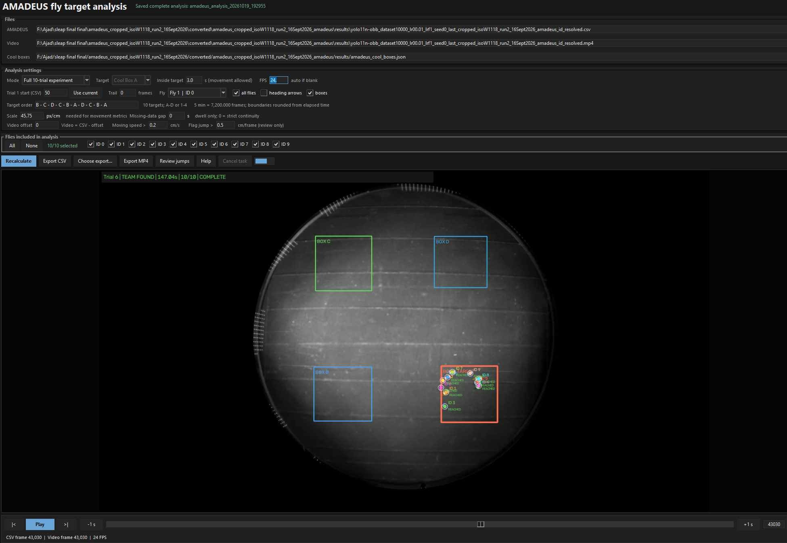
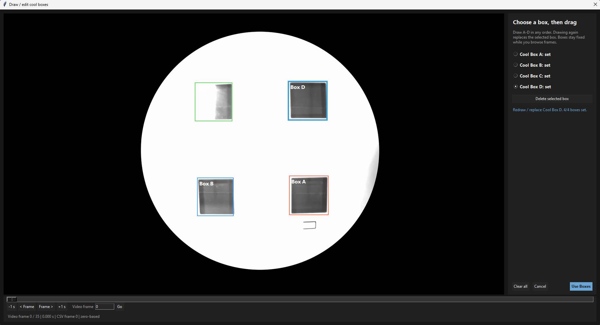
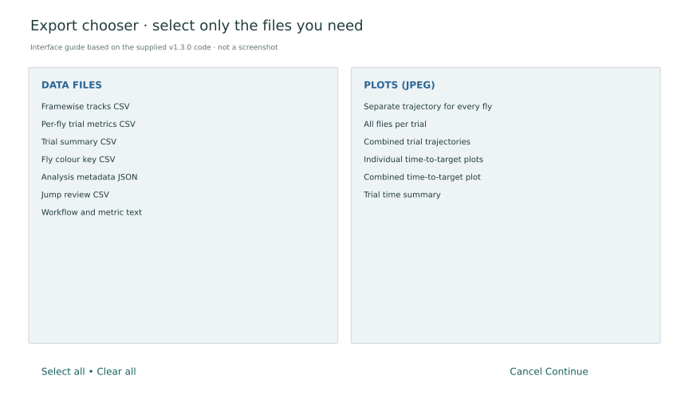

The local GUI combines video playback, target registration and analysis of reviewed AMADEUS coordinates.

## 1 · Install and launch

[Download the GUI](../downloads/analysis/fly_target_time_gui_amadeus.py). Requires Python 3.10+ and Tkinter. From its folder, run in PowerShell:

```powershell
py -m pip install numpy opencv-python pillow
py fly_target_time_gui_amadeus.py
```

The supplied **version 1.3.0** includes numerical checks:

```powershell
py fly_target_time_gui_amadeus.py --self-test
```

## 2 · Load the tracks and video

Load the reviewed AMADEUS CSV and matching video. Coordinates are in pixels. Confirm markers follow the correct flies.



## 3 · Register the four targets

Open **Draw / load**, select A–D and drag a rectangle over each tile. Use the frame slider or exact-frame control to locate a reference frame. Boxes can be replaced or deleted; their image coordinates remain fixed.

Locate tiles with the pre-experiment mask and verify labels against the controller. Select **Use Boxes** and save the JSON. All four boxes are required; overlaps are rejected.



## 4 · Set time, scale and trials

| Control | Meaning |
| --- | --- |
| Mode | One clip/trial, or the full ten-trial experiment |
| Trial 1 start (CSV) | Zero-based CSV frame where the first trial begins |
| FPS | Verified recording frame rate; blank uses video FPS when available |
| Target order | Ten A–D targets in full mode; each trial lasts 300 seconds |
| Inside target | Required continuous dwell; default 3 seconds, movement allowed |
| Scale | Pixels per centimetre for distance and speed |
| Video offset | Video frame = CSV frame − offset |

Full mode requires ten targets, each lasting 300 seconds (7,200 frames at 24 fps). Replace the default **B–C–D–C–B–A–D–C–B–A** order with the recorded sequence. Single-trial mode extends from the selected start to the CSV end.

Calibrate scale from the arena in the same video: 916 pixels across 20 cm gives **45.8 px/cm**. Recalibrate after cropping or reframing. Video offset aligns trimmed clips; it does not correct resizing, rotation or frame-rate changes.

## 5 · Select flies and calculate

**Flies included in analysis** controls calculations and exports. Retained IDs keep their original numbers and colours. The separate **Fly** selector only changes the displayed individual.

Select **Recalculate** after changing settings, boxes or included flies. Review dwell, occupancy and success times against the video. Live playback continues after success; exported paths stop at the first completed dwell.

## 6 · Review and export

Review jumps and low coverage before export. Flags do not remove points or repair identities; correct tracking in AMADEUS and reload the CSV.

Use **Export CSV**, **Choose export...** or **Export MP4**. Tables and plots can be saved separately.



[What each output means](measurements.md)
