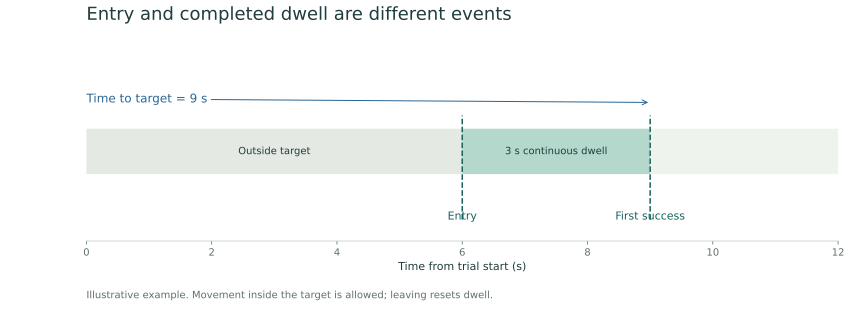

Measurements are calculated per included fly and per trial. Target success and movement use different time windows: a trajectory plot stops at first success, while movement statistics cover the full available trial.

## First success at the cool target

A centre position inside the selected rectangle counts toward target dwell. With the default three-second threshold at 24 fps, success requires 72 consecutive in-target frames. The fly can walk inside the region. Leaving the region resets the dwell; success is retained once achieved.

Time to target is measured from trial start to the **end of the frame that completes the dwell**, not the initial entry time. The CSV also records the dwell-start frame.

*Illustrative timing example, not measured data.*

**Team time** is the latest first-success time among all included flies. They do not have to occupy the target simultaneously. In the supplied version, the **all-fly mean** is available only when every included fly succeeds. If a fly does not reach the target, the team time and all-fly mean remain blank; it is not assigned zero or 300 seconds.

## Movement and occupancy

| Measurement | Calculation and interpretation |
| --- | --- |
| Path length | Sum of distances between consecutive valid positions within a trial, divided by px/cm |
| Mean tracked speed | Mean step speed over valid consecutive-frame intervals |
| Median and maximum speed | Distribution summaries of those valid step speeds |
| Trial-averaged speed | Observed path length divided by the available trial duration |
| Time moving | Valid intervals above the selected speed threshold; default 0.2 cm/s |
| Percentage moving | Moving intervals as a percentage of valid movement intervals |
| Occupancy A–D | Observed frames in each region divided by FPS |
| Net displacement | Distance between the first and last valid positions |
| Tracking coverage | Valid positions as a percentage of available trial frames |

A missing scale leaves physical movement metrics unavailable; it does not prevent target timing. Missing tracking is not interpreted as a stationary fly. Movement is not joined across missing frames or trial boundaries.

## Missing data and review

**Missing-data gap = 0** requires strict continuity. A nonzero tolerance permits a short unobserved gap only when the fly reappears inside the target; it assumes continuity across that gap. Bridged frames are recorded separately and do not increase observed occupancy.

The GUI distinguishes complete, partial and absent trial coverage. Incomplete recording coverage cannot establish a complete-trial failure. Even a complete frame span can contain missing positions, so interpret non-reaching outcomes alongside each fly's coverage.

Jump review flags steps above the selected displacement threshold, by default 0.5 cm per frame. Flagged positions remain in calculations. The GUI neither smooths coordinates nor interpolates missing positions nor reassigns identities.

## Choose the outputs

| Output | Contents |
| --- | --- |
| `per_fly_trial_metrics.csv` | Target success, occupancy, movement, coverage and jump counts for each fly and trial |
| `trial_summary.csv` | Group completion, all-fly mean when available, reached count and trial summaries |
| `framewise_tracks.csv` | Original coordinates, timing, target membership, dwell, speed and validity at each frame |
| `jump_review.csv` | Flagged steps with frame numbers for review |
| `fly_color_key.csv` | Original AMADEUS IDs and display colours |
| `trial_tracks/` and `fly_tracks/` | All-fly and individual trajectories, ending at first success |
| Time-to-target plots | Individual trial plots, combined plots and group summary |
| `analysis_metadata.json` | Settings, definitions, included/excluded IDs, input hash and selected-output hashes |
| `READ_ME.txt` | Workflow and measurement definitions |
| Annotated MP4 | Tracking overlay; exported trails and markers stop at success within each trial |

Plots in this supplied version are **JPEG**. Full-experiment time-to-target axes run from 0 to 300 seconds. CSVs retain floating-point values for further plotting or statistics. Exported MP4 behaviour differs from live playback, which keeps following flies after success.

## Reproducible analysis

Save the tracking CSV, box JSON, metadata and video together. Record exclusions consistently: changing the included population changes group completion and averages. The source includes 47 automated numerical checks covering timing, missing data, trial boundaries and exports; passing these checks does not validate the identities in an experimental recording.

[Download the exact analysis source](../downloads/analysis/fly_target_time_gui_amadeus.py) · [Return to the GUI workflow](gui.md)
