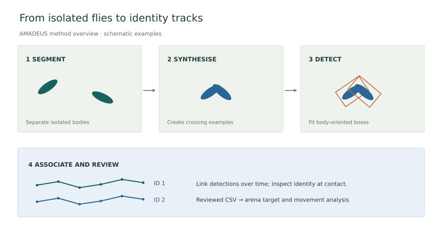

AMADEUS learns from unlabelled recordings and represents each animal with an **oriented bounding box**.

## How tracking works

Segmentation extracts isolated animals for training. Movement supplies initial direction labels; synthetic crossings and clusters extend the training set. A YOLO detector locates animals, and temporal association links detections into tracks. Direction and identity are refined separately. [Method and preprint](https://www.biorxiv.org/content/10.64898/2026.09.19.752854v1).

*Method diagram, not an experimental recording.*

## Choice of tracker

This assay requires stable identities and centre coordinates, rather than detailed poses. Our earlier SLEAP workflow showed identity swaps during contact and missed detections near the edge. AMADEUS supports recording-specific training, synthetic interactions and identity review.

| Requirement | AMADEUS in this workflow | SLEAP |
| --- | --- | --- |
| Main representation | Body box and centre position | User-defined body keypoints and pose |
| Training preparation | Examples generated from segmented video | A labelled pose dataset |
| Arena measurements | Centre coordinates feed directly into the target GUI | Pose coordinates require a chosen tracking point |

This choice is not a measured accuracy comparison. Review AMADEUS identities around occlusions. [SLEAP](https://sleap.ai/) remains an option for pose analysis.

## Tracking sequence

1. In **Easy Tracking**, select the video and session, then **Launch Segmentation**.
2. Adjust segmentation: isolated flies should be blue/cyan; contacts, fragments and outliers orange. Check the arena edge.
3. Process segmentation; set animal count, overlap severity and backward motion.
4. Run training and tracking. **Advanced Tracking** exposes individual stages; very heavy overlap adds contrastive identity verification at extra processing cost.
5. Review overlays in **Refinement**, correct errors and save the reviewed CSV.

Use stable lighting and a fixed camera. See the [AMADEUS manual](https://amadeus.jpmyrmecol.com/Manual_EN.html) for installation and current controls.

## Hand-off to the arena GUI

Preserve the tracked video geometry. The GUI expects a wide CSV with `frame` and paired centre columns (`cx0, cy0, cx1, cy1`, etc.). Width, height and heading are optional; original IDs are retained.

[Continue to the analysis GUI](gui.md)
