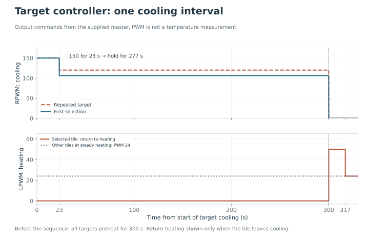

One ESP32 controls four bidirectional drivers. Each driver connects to one Peltier, allowing one target to cool while the other three heat. The background circuit is separate.

## Why each tile has its own driver

A bidirectional driver, or **H-bridge**, can reverse the current through a load. This lets the same tile switch between heating and cooling. Four separate drivers allow the master to change one target without reversing the other three.

Each tile has two wires, both connected to its driver's output pair. The master's GPIO pins connect only to the driver inputs. RPWM and LPWM select the two drive directions; R_EN and L_EN enable the driver. The load supply provides the energy used by the tile.

## Target controller pin map

| Target | Manual number | Driver channel | RPWM | LPWM | R_EN | L_EN |
| --- | --- | --- | --- | --- | --- | --- |
| A | 1 | 3 | 27 | 14 | 23 | 22 |
| B | 2 | 2 | 25 | 26 | 13 | 15 |
| C | 3 | 4 | 19 | 18 | 21 | 17 |
| D | 4 | 1 | 32 | 33 | 4 | 5 |

RPWM, LPWM and enable values are ESP32 GPIO numbers. The master uses **LPWM for heating and RPWM for cooling** at 20 kHz with 8-bit PWM. Check the current direction against the installed Peltier polarity.

## Wire and identify one channel first

Follow the [power and target connections](wiring.md#power-and-target-connections) with the supplies disconnected. Trace one target from its letter through the pin table to its driver and output pair. Label both ends of each cable before connecting the remaining targets.

After the controller starts, use its documented manual command to test a single output under temperature observation. A command for manual target 1 refers to A, which uses driver channel 3. A printed driver number alone is therefore not enough to identify the arena location.

Keep the same physical labels in the video, temperature regions and trial order. If the intended cooling command heats the walking face, stop and check polarity and the loaded sketch before proceeding.

<figure class="photo-slot" data-photo-id="target-four">

<figcaption>Photo · H09<strong>The four target channels</strong></figcaption></figure>

## Trial sequence

The master preheats all targets for five minutes. Each selected target then cools for 300 seconds.

| Stage | Output |
| --- | --- |
| Initial cooling | PWM 150 for 23 s |
| Remaining 277 s | PWM 106 on first selection; 120 on a repeat |
| Other targets | Heating at PWM 24 |
| Return to heating | PWM 50 for 17 s, then 24 |

The plot shows the commands sent to the driver. It is not a temperature trace. A repeated selection uses the repeat hold value because the program tracks whether that target has already appeared in the sequence.

The intended target range is **23–25 °C**. Measured performance requires temperature traces for all four targets and the background; PWM settings alone do not establish surface temperature.

Every step in this program cools a target. The alternative bench controller uses different enable pins and the opposite PWM direction.

## How the four targets affect the rest of the arena

The tiles share their surroundings even though their electrical outputs are separate. A cooling target rejects heat below the surface. If that heat enters the common carrier or warm air is trapped beneath it, the background and other tiles can warm. A target that has just stopped cooling also takes time to return to the heating condition.

Record all four temperatures and the background on the same time axis. For each selection, compare the time to cool, the temperature maintained during the hold, and recovery after switching away. The best single minimum does not show whether a target remained suitable for the whole trial. A measured comparison of A–D is not available.

[Master code](../firmware/master.md) · [Operating procedure](../operation.md) · [Wiring](wiring.md)
