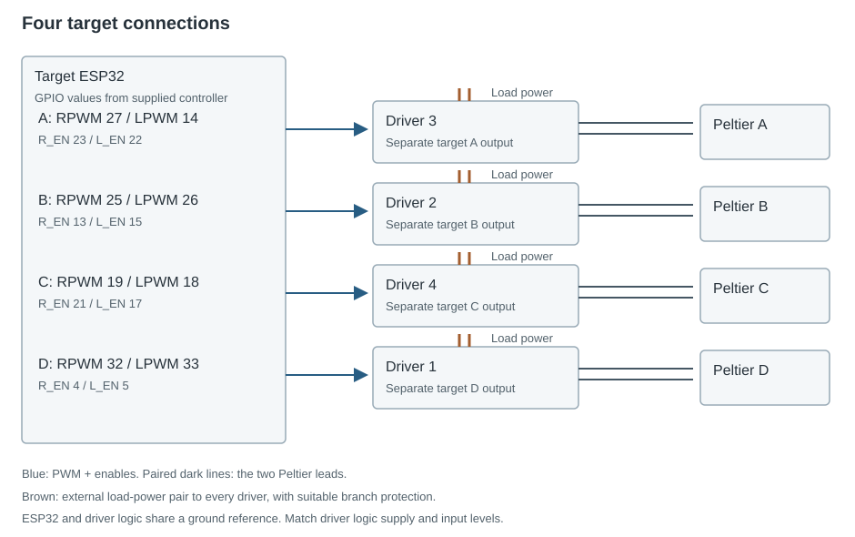

One ESP32 controls four bidirectional drivers. Each driver connects to one Peltier, allowing one target to cool while the other three heat. The background circuit is separate.

## Target controller pin map

| Target | Manual number | Driver channel | RPWM | LPWM | R_EN | L_EN |
| --- | --- | --- | --- | --- | --- | --- |
| A | 1 | 3 | 27 | 14 | 23 | 22 |
| B | 2 | 2 | 25 | 26 | 13 | 15 |
| C | 3 | 4 | 19 | 18 | 21 | 17 |
| D | 4 | 1 | 32 | 33 | 4 | 5 |

RPWM, LPWM and enable values are ESP32 GPIO numbers. The master uses **LPWM for heating and RPWM for cooling** at 20 kHz with 8-bit PWM. Check the current direction against the installed Peltier polarity.

## Trial sequence

The master preheats all targets for five minutes. Each selected target then cools for 300 seconds.

| Stage | Output |
| --- | --- |
| Initial cooling | PWM 150 for 23 s |
| Remaining 277 s | PWM 106 on first selection; 120 on a repeat |
| Other targets | Heating at PWM 24 |
| Return to heating | PWM 50 for 17 s, then 24 |

The intended target range is **23–25 °C**. Measured performance requires temperature traces for all four targets and the background; PWM settings alone do not establish surface temperature.

Every step in this program cools a target. The alternative bench controller uses different enable pins and the opposite PWM direction.

[Master code](../firmware/master.md) · [Operating procedure](../operation.md) · [Wiring](pcb.md)
