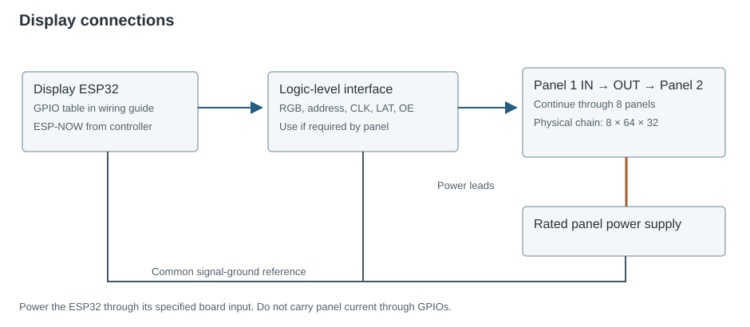
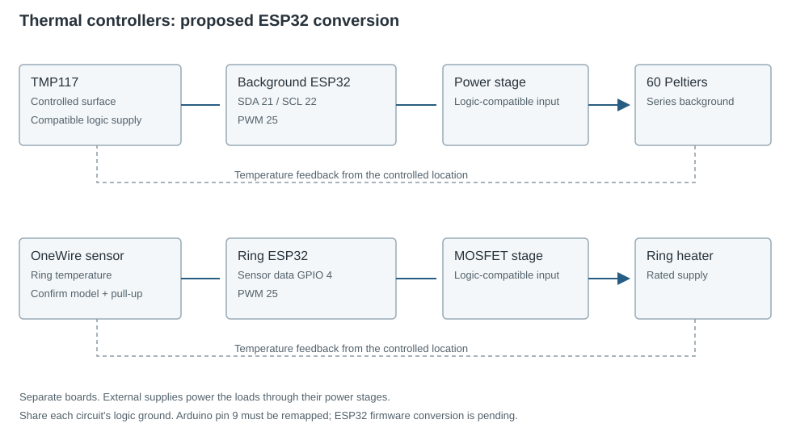

The PCB connects the ESP32 boards to the driver and display signals. Peltier current passes through the external drivers and their power wiring.

## PCB layout

KiCad symbols and footprints are based on the installed boards. Measure the header spacing and check the pin order before placing connectors. The 30-pin and 38-pin ESP32 variants require different footprints.

## ESP32 control

The target ESP32 runs the trial sequence and generates PWM signals for the drivers. Each H-bridge reverses the Peltier current to select heating or cooling. ESP-NOW sends the selected target to a separate display ESP32.

Use **ESP32-WROOM boards** for the proposed common controller platform. The background and ring sketches need revised pin assignments and PWM calls before conversion. Their Arduino pin 9 cannot be transferred to a classic ESP32-WROOM, where GPIO9 connects to flash.

## Power and target connections

| Connection | Destination |
| --- | --- |
| Regulated logic supply | ESP32 board input and compatible driver logic supply |
| Target power supply | Fused supply to each driver's load-power terminals |
| PWM and enable GPIOs | Driver RPWM, LPWM, R_EN and L_EN |
| Driver output pair | The two leads of its Peltier |
| Control reference | Common ESP32 and driver logic ground |
| High-current return | Back to the power supply, not through thin signal wiring |

1. Connect each target to its own driver's output pair.
2. Connect PWM and enable signals using the [target pin table](four-channels.md#target-controller-pin-map).
3. Connect the driver power supply and common logic ground. Check supply ratings and logic levels before powering the circuit.

Keep both Peltier leads on the H-bridge output. Neither lead should connect directly to an ESP32 pin or be permanently grounded.

## Display board pin map

| HUB75 signal | ESP32 GPIO |
| --- | --- |
| R1 / G1 / B1 | 2 / 15 / 4 |
| R2 / G2 / B2 | 16 / 27 / 17 |
| A / B / C / D / E | 5 / 18 / 19 / 21 / 12 |
| LAT / OE / CLK | 25 / 26 / 22 |

Connect the display controller to the first panel's data input, then connect each output to the next panel's input. Power the panels directly from their rated supply. Use a suitable level interface where 5 V logic is required.

## Background, ring and camera

The following connections are for the **proposed ESP32 conversion**. The background and ring each use a separate controller; the existing Arduino pin assignments are listed on their code pages.

| Circuit | Signals | Load power |
| --- | --- | --- |
| Background, proposed | TMP117 SDA 21 / SCL 22; PWM 25 | Through a suitable power stage to the 60-module string |
| Ring, proposed | OneWire data 4; PWM 25 | Through a suitable MOSFET stage to the heater |
| Thermal camera, supplied | MLX90640 SDA 21 / SCL 22 on its own ESP32; USB to computer | Rated sensor-breakout supply |
| Lower fan | Independent unless a control circuit is added | Supply matched to the fan label |
| IR illumination | Independent of display data | Rated illumination supply |

Use ESP32-compatible sensor logic and pull-ups. Confirm the OneWire sensor model before selecting its pull-up and supply. Keep each controller's signal ground referenced to its own sensors and power stage.

[ESP32 board reference](https://docs.espressif.com/projects/esp-dev-kits/en/latest/esp32/esp32-devkitc/user_guide.html) · [Controller code](../firmware/index.md)
