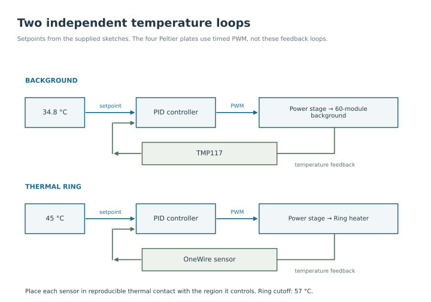

A Peltier module moves heat between two ceramic faces when current passes through it. Its orientation and current direction determine which face warms and which cools. The background circuit controls the common floor temperature while the four target circuits create local cooling spots.

## How a Peltier changes temperature

The module contains many pairs of semiconductor elements. Current carries heat from one face to the other through these junctions. Reversing the current reverses this heat transfer. Electrical resistance also produces heat, so cooling the top face always requires removing heat from the bottom face.

The temperature difference is not fixed by the module or by a PWM number. It depends on current, thermal contact, the heat entering the cold face and how well the opposite face exchanges heat with its surroundings. Test the installed module with a temperature measurement rather than identifying its hot face from wire colour alone.

## Background circuit

The documented background uses 60 modules in one series circuit. In a series circuit, the same current passes through each module and their voltage drops add. The background therefore has one power-control output, not 60 independent outputs.

The TMP117 sensor measures temperature at its mounting location. The Arduino reads it over I²C and sends a PWM signal from pin 9 to a separate power stage. That stage controls the module circuit. Sensor wires carry information; load wires carry the Peltier current.

<figure class="photo-slot" data-photo-id="background-sensor">

<figcaption>Photo · H08<strong>Background circuit and sensor position</strong></figcaption></figure>

## Why closed-loop control is used

Room temperature, fan airflow and heat from the targets change during use. A fixed power setting cannot compensate for all of these changes. Closed-loop control repeatedly measures temperature, compares it with the requested value and adjusts the output.

The controller uses **PID** to decide the adjustment:

| Part | Plain-language meaning | Role in this circuit |
| --- | --- | --- |
| Proportional, P | Respond to the present temperature error | Apply more correction when the reading is farther from the setpoint |
| Integral, I | Accumulate persistent error over time | Correct an offset that remains after the first response |
| Derivative, D | Respond to how quickly the error changes | Help moderate a rapidly changing response |

These terms work together. Changing their gains changes the response of the assembled system. Keep the supplied settings as a documented starting point, then assess stability with the actual sensor position and load.

## Feedback loops

The background and ring have separate sensors and power outputs. The four target tiles follow a timed PWM sequence instead. The thermal camera records their temperatures but does not send corrections to the experiment controller.

## Connect and check the background

1. Mount the sensor in reproducible thermal contact with the region to be controlled. Secure its cable so handling does not lift the sensor.
2. Connect sensor power, ground, SDA and SCL to the appropriate pins for the actual Arduino board. Connect pin 9 to the power-stage control input. Follow the [wiring guide](wiring.md#supplied-arduino-thermal-controllers).
3. With load power disconnected, upload the background program and check its reading at room temperature. The program begins control automatically when powered, so keep the load disconnected during this check.
4. Verify the assembled supply, power-stage ratings and module polarity before enabling load power. Watch whether the measured surface moves toward the target.
5. Record warm-up and a complete target sequence. Check the centre and perimeter of the walking surface as well as the control sensor.

The supplied code starts at **34.8 °C** and limits PWM to **150/255**. It attempts a sensor read every 100 ms and smooths the reading before control. These settings do not establish that every background module reaches 34.8 °C.

## Measure the whole floor

Record a temperature map of the assembled surface and compare representative background regions while A, B, C and D are selected. Look for gradients, edge losses and slow warming over repeated trials. One feedback sensor cannot detect every local hot or cold area.

The feedback figure describes the control connections; it does not present measured performance. See [temperature recording](../hardware/imaging.md#set-up-the-thermal-camera) for the measurement procedure.

[Background code](../firmware/background.md) · [Four-target control](four-channels.md) · [Heat removal](thermal-coupling.md)
