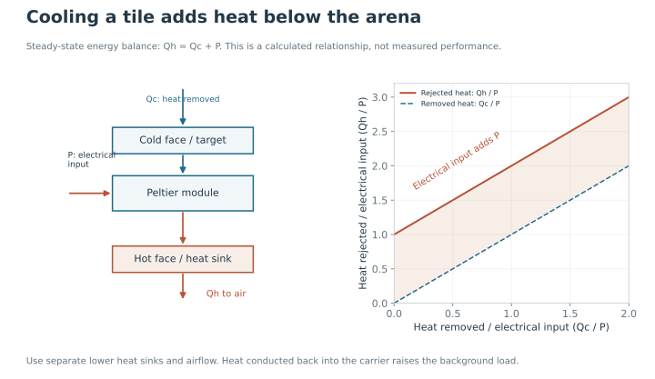

Cooling a target heats its underside. Contact with the shared aluminium carrier conducts this heat into the background and neighbouring targets. Repeated cooling increases the heat load.

Heat rejected = heat removed from the target + electrical input

## Follow the heat path

Heat enters the cold face from the walking surface and surrounding material. The Peltier moves it to the opposite face, where electrical input adds more heat. That heat must pass into a heat sink and then into moving air. A warm heat sink makes further cooling harder, even if the controller continues sending the same PWM value.

This energy-balance plot is calculated, not an experimental trace. It explains why removing heat below the arena matters when a tile is being cooled above it.

## Proposed heat-sink assembly

1. Mount a **separate finned aluminium heat sink** against the hot underside of each target.
2. Use a thin thermal interface and even clamping to maintain contact.
3. Place the fan below the arena and direct air through the fins. Route the warm exhaust away from the carrier and outside the fly chamber.

The fan removes heat from the sinks, reducing heat accumulation beneath the cooling tiles.

<figure class="photo-slot" data-photo-id="underside-airflow">

<figcaption>Photo · H10<strong>Underside and airflow path</strong></figcaption></figure>

Fan position alone is not enough. Leave space for air to enter, pass through the fins and leave without returning directly to the intake. Keep the airflow below the walking chamber so it does not introduce an additional behavioural cue. Record the fan orientation and operating setting with the thermal measurements.

## Target isolation

Four machined openings reduce conductive contact between the targets and carrier. The walking surface must remain level and fly-tight. Metal bridges across the openings would increase heat transfer between the targets and background.

Use measured module dimensions to specify the openings for CNC milling or conventional machining. Check a single opening and its support arrangement before making the complete carrier. The required clearance, clamping and surface covering must be resolved together: removing metal without providing support would leave the tile mechanically unstable.

## Check that the change helps

Compare temperature recordings with the same target order, starting temperature and drive settings. Measure the target surfaces, representative background areas and accessible underside points. A useful heat-removal arrangement keeps target cooling repeatable while limiting slow background warming. It should also maintain level, secure mounting.

Validation requires target, background and underside temperature traces during the trial sequence.

[Heat-sink guidance](https://thermal.ferrotec.com/technology/thermoelectric-reference-guide/thermalref05/) · [Module mounting](https://thermal.ferrotec.com/technology/thermoelectric-reference-guide/thermalref06/)
