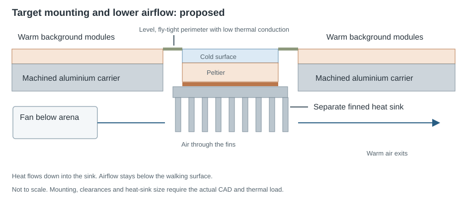

Cooling a target heats its underside. Contact with the shared aluminium carrier conducts this heat into the background and neighbouring targets. Repeated cooling increases the heat load.

Heat rejected = heat removed from the target + electrical input

## Proposed heat-sink assembly

1. Mount a **separate finned aluminium heat sink** against the hot underside of each target.
2. Use a thin thermal interface and even clamping to maintain contact.
3. Place the fan below the arena and direct air through the fins. Route the warm exhaust away from the carrier and outside the fly chamber.

The fan removes heat from the sinks, reducing heat accumulation beneath the cooling tiles.

## Target isolation

Four machined openings reduce conductive contact between the targets and carrier. The walking surface must remain level and fly-tight. Metal bridges across the openings would increase heat transfer between the targets and background.

Validation requires target, background and underside temperature traces during the trial sequence.

[Heat-sink guidance](https://thermal.ferrotec.com/technology/thermoelectric-reference-guide/thermalref05/) · [Module mounting](https://thermal.ferrotec.com/technology/thermoelectric-reference-guide/thermalref06/)
