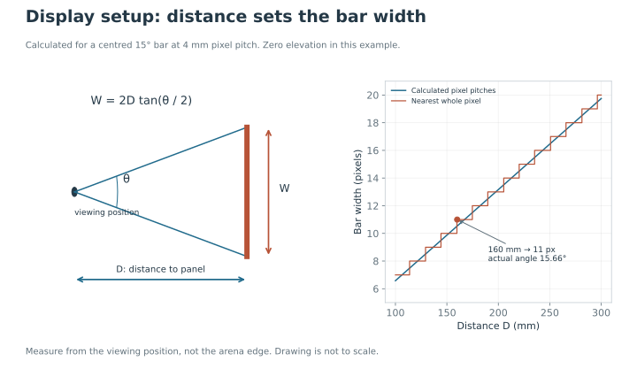

Eight P4 HUB75 panels surround the arena. Each panel contains 64 × 32 pixels at **4 mm pitch**, the distance between neighbouring pixel centres. The displayed bars provide a visual reference; their apparent width depends on the animal's distance from the panel.

## Assemble and test the enclosure

Arrange the panels around the walking area with their display faces inward. Keep the enclosure centred relative to the arena, and measure the distance to the active panel plane. Check that supports and cables do not obstruct the view or prevent the access panel from opening.

Connect the first panel's OUT connector to the next panel's IN connector, continuing through the chain. Supply power through the panel power connectors. Follow the [display pin map](wiring.md#display-board-pin-map), then test one panel before loading the complete panorama program.

The program treats the rotated panels as a logical image 256 pixels wide and 64 pixels high. Physical panel order and orientation must match this mapping. Send A, B, C and D directly to the display board to check each pattern position before testing the wireless link.

<figure class="photo-slot" data-photo-id="led-enclosure">

<figcaption>Photo to add · V01<strong>Panel enclosure and cable order</strong>
Show the first panel, chain direction and access panel.
</figcaption></figure><figure class="photo-slot" data-photo-id="led-pattern">

<figcaption>Photo to add · V02<strong>Displayed visual pattern</strong>
Show the vertical, horizontal and diagonal regions in a known target state.
</figcaption></figure>

## Setting the bar width

1. Measure the distance **D** from the reference viewing position to the panel plane.
2. Calculate the width **W** for the required angular width **θ** using the equation below.
3. Divide the width by 4 mm to obtain the pixel count. Recalculate the angle after rounding.

W = 2D tan(θ / 2)

Measure from the viewing position rather than the arena edge. This calculation assumes a bar centred on the viewing direction.

At 160 mm, a 15° bar is **42.13 mm**, or **10.53 pixel pitches**. An 11-pixel bar is 44 mm and subtends about 15.66°. Full-size paper templates provided a dimensional check before display programming.

Measure the actual display distance after fitting the panels. The 160 mm value above is an example, not a fixed arena dimension. Measure height relative to the walking surface too. The calculator below includes elevation for a horizontal span; it is not a calibration of every diagonal or off-centre viewing position.

Angular-width calculator

  

    <label>Distance to panel plane (mm)<input id="distance-mm" type="number" min="1" value="160" step="1"></label>
    <label>Pattern centre above fly (mm)<input id="height-mm" type="number" value="0" step="1"></label>
    <label>Angular width (degrees)<input id="angle-deg" type="number" min="0.1" max="89" value="15" step="0.1"></label>
  

  
42.13 mm · 10.53 pixel pitches at 4 mm pitch

  
Example geometry. Assumes a centred horizontal span on a flat panel viewed along its normal; elevation is included. It is not a whole-arena optical calibration.

## Display pattern geometry

The included LED program draws diagonals at about **19.5° from vertical**. The archived 45° design uses a different pattern.

The horizontal region is **344 mm long**. Its bars are 11 and 10 rows thick in the supplied sketch. A moving fly sees a changing angle, so the centre-based calculation is a reference, not a constant across the arena.

## Verify the pattern before a run

Check the direction of rotation, bar count and continuity across panel boundaries for each target state. Save a photograph of each state with the same exposure. Confirm pixel dimensions from the program and physical geometry from measurements; a photograph alone can hide scan artefacts or make a bar appear thicker.

The LED program's requested refresh setting is separate from the behaviour camera's frame rate. A firmware setting is not a measured panel refresh rate. Assess the actual display timing on the assembled hardware before assigning a measured value to it.

[Read the display code](../firmware/display.md)
