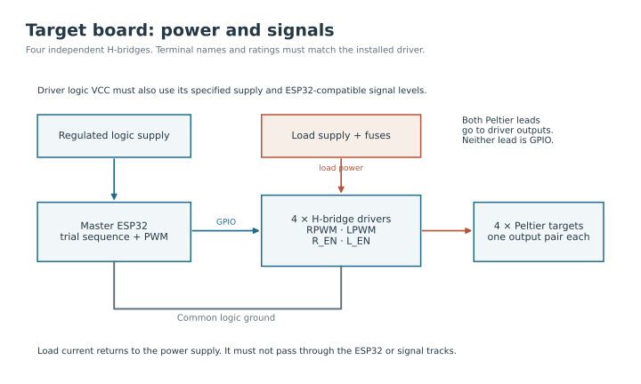

A controller sends low-power instructions to a driver and reads information from a sensor. The driver switches the larger current used by a heater or Peltier. Keep these two paths separate when following the connections below.

## Identify and label the boards

| Label to put on the board | Program | Job |
| --- | --- | --- |
| Target ESP32 | Master_Controller | Four target tiles and experiment timing |
| Display ESP32 | LED_Slave | The eight-panel panorama |
| Background Arduino | Closedloop_60peltier | One temperature loop for the 60-module circuit |
| Ring Arduino | Thermal_ring | A separate temperature loop for the ring heater |
| Thermal-camera ESP32 | thermal_camera | Temperature images sent to the computer |

The background and ring sketches use Arduino-style pin assignments. Confirm the actual Arduino model before wiring: its I²C pins depend on the board. An `.ino` file can also run on an ESP32 when written for it; the file extension does not identify the hardware.

The ESP32 pin maps here refer to the classic ESP32 used by the supplied programs. Other ESP32 families, such as the C3, have different pins and peripherals. Match the board itself, not just the word ESP32 on its label.

<figure class="photo-slot" data-photo-id="esp32-board">

<figcaption>Photo to add · H02<strong>ESP32 board and pin labels</strong>
Top view with the module name, USB socket and both header rows visible.
</figcaption></figure><figure class="photo-slot" data-photo-id="arduino-board">

<figcaption>Photo to add · H03<strong>Arduino thermal controller</strong>
Show the exact board model and its printed pin names.
</figcaption></figure>

## Read a connection table

**GPIO** means a numbered signal pin on an ESP32. GPIO 27 means the pin labelled 27, not the twenty-seventh pin along the header. **GND** is the electrical reference shared by the controller and the connected driver or sensor. **VCC**, **VIN** and **3V3** are supply labels, but they are not interchangeable: check the particular module before connecting power.

**SDA** and **SCL** are the data and clock wires of I²C, a two-wire sensor interface. **PWM** means the output switches on and off rapidly; changing its on-time changes the average drive. The master uses values from 0 to 255. A value of 150 is an output setting, not 150 °C or a guaranteed cooling temperature.

## Power and target connections

1. With all supplies disconnected, label the four drivers and the two leads from each target tile. Match the letters to the [target pin table](four-channels.md#target-controller-pin-map).
2. Connect the ESP32 PWM and enable pins to the matching driver signal inputs. The enable inputs permit a driver to operate; they do not power the Peltier themselves.
3. Connect the controller ground and driver logic ground. Route the high-current return directly back to the load supply rather than through thin controller wiring.
4. Connect the Peltier's two leads to that driver's output pair. Neither Peltier lead belongs on a GPIO pin or directly on ground.
5. Connect the driver's logic supply and load supply to their separately identified terminals. Match their voltage, current and logic-level requirements to the actual driver.
6. Check the wiring with load power off. Then test one channel while observing its surface temperature. Establish which physical face heats before connecting all four channels.

The ESP32 supply powers the controller. The Peltier supply powers the load through its driver. Use the development board's documented power-input method; do not assume USB and an external supply can be connected together without checking the board's power circuit.

<figure class="photo-slot" data-photo-id="driver-connections">

<figcaption>Photo to add · H04<strong>One complete target channel</strong>
Show the ESP32 signal wires, driver input labels, power terminals and Peltier output pair.
</figcaption></figure>

## Display board pin map

Use a separate ESP32 for the display. The following pins belong to the supplied LED program, not the target controller.

| HUB75 signal | ESP32 GPIO | What it carries |
| --- | --- | --- |
| R1 / G1 / B1 | 2 / 15 / 4 | Colour information for one row group |
| R2 / G2 / B2 | 16 / 27 / 17 | Colour information for the other row group |
| A / B / C / D / E | 5 / 18 / 19 / 21 / 12 | Row-address signals, as defined in the sketch |
| LAT / OE / CLK | 25 / 26 / 22 | Latch, output enable and clock |
| GND | Controller and panel signal ground | Shared signal reference |

Connect the controller to the first panel's **IN** connector. Connect that panel's **OUT** to the next panel's **IN** and continue in the documented panel order. The ribbon cable carries display signals; supply panel power through the rated power connectors. Check whether the actual panels require a suitable logic-level interface between the 3.3 V ESP32 signals and their inputs.

First test a single panel using the [panel-test program](../firmware/panel-test.md). Restore the LED-slave program before testing the full experiment. ESP-NOW sends the selected target wirelessly from master to display; it does not replace panel power or the HUB75 cable.

## Background, ring and camera

### Supplied Arduino thermal controllers

| Circuit | Controller connection | Destination |
| --- | --- | --- |
| Background sensor | Board's SDA and SCL pins | TMP117 SDA and SCL |
| Background drive | Arduino pin 9 | PWM input of the correctly rated power stage |
| Background indicator | Arduino pin 13 | Indicator used by the sketch |
| Ring sensor | Arduino pin 2 | OneWire sensor data |
| Ring drive | Arduino pin 9 | Input of the ring MOSFET power stage |
| Each sensor | Compatible supply and GND | Sensor supply pins; follow its breakout documentation |

The two pin-9 outputs are on **different boards**. Do not connect them together. The TMP117 requires I²C wiring, whereas the ring sensor uses a single data line. Confirm the OneWire sensor model and the required pull-up arrangement before assembling it; a pull-up is a resistor that holds a data line at its idle logic level.

The background circuit is documented as 60 modules in series. Its load supply and power stage must be selected for the complete circuit. A GPIO pin, USB output or small breadboard power rail cannot drive this string. Its actual module, supply and driver ratings are still required for a complete power schematic.

The power stage must accept the controller's logic level. With a non-isolated stage, connect its signal ground to the corresponding controller ground as specified by the driver. Route load current through the supply and load terminals. A PWM signal connected without its required reference ground can behave unpredictably even when the pin numbers are correct.

### Proposed ESP32 conversion

| Separate controller | Sensor pins | Proposed drive pin |
| --- | --- | --- |
| Background ESP32 | SDA 21 / SCL 22 | GPIO 25 |
| Ring ESP32 | OneWire data 4 | GPIO 25 |

These are proposed assignments, not a drop-in wiring change. The thermal sketches need their pin definitions and PWM code adapted before using them. Do not copy Arduino pin 9 to GPIO9 on a classic ESP32-WROOM board, where that connection is used by flash memory.

Using ESP32 boards for future thermal controllers would make the board types more consistent and provide flexible PWM outputs. Retain the documented Arduino setup until the converted programs have been compiled and checked with their sensors and drivers. ESP32 inputs use 3.3 V logic, so sensor pull-ups and driver interfaces must also be compatible.

### Thermal camera and other loads

The supplied camera sketch uses a third ESP32: **GPIO21 → SDA**, **GPIO22 → SCL**, with the sensor breakout's compatible supply and a common ground. USB carries its data to the computer. Fans and IR lights use supplies matched to their labels; they are not powered from signal pins.

## Check before connecting load power

Check connector polarity, loose strands and continuity with power disconnected. Confirm each controller can start and communicate over USB before adding its load. Keep a written label-to-port record so a command intended for one board is not sent to another.

[ESP32 board power and pin reference](https://docs.espressif.com/projects/esp-dev-kits/en/latest/esp32/esp32-devkitc/user_guide.html) · [Install and upload](../software/upload.md)
