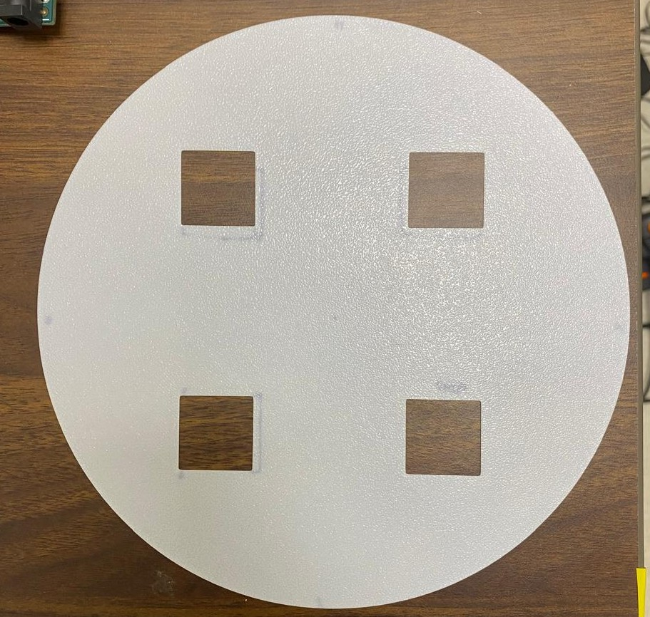

Six editable STEP models cover the arena supports, display enclosure, lighting, thermal ring and target registration.

## 01 · Structural baseplate

The wooden baseplate fixes the arena and supports in position. The geometry can also be cut from acrylic, aluminium or another rigid sheet.

[Download the baseplate STEP file](../downloads/cad/wooden-baseplate.step)

## 02 · LED matrix octagon and access hinge

Printed TPU or PLA legs hold eight 64 × 32 panels in an octagon. One hinged panel opens for loading flies and returns to its recording position.

[Download the LED matrix octagon STEP file](../downloads/cad/led-matrix-octagon.step)

## 03 · Infrared-light stand

A PVC support carries a printed lampshade, infrared array and diffuser. A printed tube can replace the PVC pipe.

[Download the IR light stand STEP file](../downloads/cad/ir-light-stand.step)

## 04 · Thermal ring

The PLA ring contains a copper-wire resistive heater. Small openings provide air exchange.

[Download the thermal ring STEP file](../downloads/cad/thermal-ring.step)

## 05 · Cool-spot registration mask

Image the mask before each experiment to register the four target positions. Remove it before introducing flies without changing camera framing.

<figure markdown="1" style="border: 1px solid #d6d6d6; padding: 12px; margin: 24px 0; text-align: center;">

<figcaption>Cool-spot registration mask.</figcaption>

</figure>

[Download the cool-spot mask STEP file](../downloads/cad/cool-spot-mask.step)

## 06 · Peltier-plate holder and fan support

The holder stabilises the baseplate around the four Peltier plates and supports a fan below. Underside airflow removes heat from the cooling hardware.

[Download the Peltier-plate holder STEP file](../downloads/cad/peltier-tile-holder.step)
