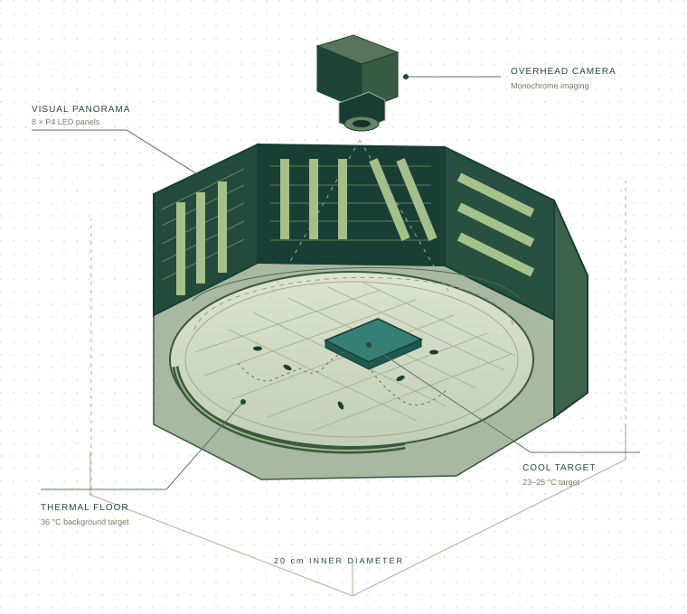
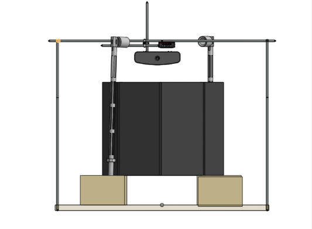

## Architecture at a glance

The apparatus creates a controlled relationship between a cool target and visual landmarks, then records how flies move through that environment. Mechanical, electrical, and software modules are documented separately so that each can be tested before integration.

*Conceptual illustration, not to scale. Target location, number of visible flies, and floor grid are schematic rather than a construction drawing.*

| Subsystem | Current project record | Role |
| --- | --- | --- |
| Arena | Circular walking arena; 20 cm inner diameter; glass cover | Constrain the observed walking space |
| Target control | Four channels labelled A–D; ESP32 and BTS7960 drivers | Select and drive the cool target |
| Thermal programme | Warm target 36 °C; cool target approximately 23–25 °C | Establish the thermal contrast |
| Visual surround | Eight P4 HUB75 panels, each 64 × 32 pixels | Present panoramic landmarks |
| Display coordinates | 512 × 32 native chain; 256 × 64 virtual arrangement | Map the vertically mounted panels |
| Imaging | Thorlabs CS165MU monochrome camera; main dataset 24 fps | Record positions over time |
| Illumination | 850 nm, 12 V IR rings; four-ring configuration reported | Provide imaging contrast |
| Analysis | SLEAP and AMADEUS workflows; custom target-time analysis | Recover individual behaviour |

Temperature entries are operating targets. They do not certify the measured temperature or uniformity of an arbitrary build.

## Control and measurement flow

1. A trial controller selects target A, B, C, or D and applies the thermal programme.
2. The display controller receives the associated panorama state. The supplied `LED_Slave.ino` uses ESP-NOW and also supports local serial testing.
3. An overhead camera records the arena under IR illumination.
4. Tracking software estimates positions and identities.
5. Spatial calibration, trial boundaries, target regions, and inclusion decisions determine the analysis.
6. Quality review precedes interpretation of the exported metrics.

A software command being sent does not prove that a target reached its intended temperature or that the panel changed on the same video frame. Record those transitions during commissioning.

## Physical assembly

The project has progressed from an acrylic support base toward a **4 mm aluminium plate, 220 × 225 mm**, with a surrounding display enclosure and overhead camera/lighting supports. Four approximately **100 mm supports** were developed for breadboard mounting. The original visual assembly provides context for how the display and imaging structures are arranged.

*Earlier project CAD illustration. It is retained as a design record and is not a verified drawing of every current component.*

## Build and commission by subsystem

| Stage | Practical verification before integration |
| --- | --- |
| Mechanical frame | Arena level, rigid support, glass clearance, repeatable access |
| Thermal assembly | Measured transient and steady-state temperatures at fly height and on the floor |
| Visual surround | Correct panel order, orientation, physical target correspondence, and all four panorama states |
| Camera and IR | Focus, contrast, reflections, missing frames, fixed field of view |
| Trial timing | Video-visible or logged transition markers tied to an explicit frame origin |
| Tracking | Isolated animals, pair contacts, clusters, and edge passages reviewed |
| Analysis | Known calibration, target regions, frame rate, inclusion set, and export definitions |

## Bill of materials: functional inventory

This inventory is a starting point for a reproducible build. It does not claim current vendor prices or a verified total cost.

| Component | Recorded quantity or configuration | Documentation |
| --- | --- | --- |
| P4 HUB75 LED panels | 8, each 64 × 32 | [Visual display](hardware/visual_display_system.md) |
| Display controller | ESP32 | [Controllers](hardware/esp32.md) |
| Thermal controller and drivers | ESP32, four target channels, BTS7960 drivers | [Thermal system](hardware/thermal_control_system.md) |
| Warm-floor Peltier assembly | Earlier 60-module series test recorded; final assembled inventory needs a revisioned BOM | [Thermal system](hardware/thermal_control_system.md) |
| Nichrome ring and MOSFET | Separate perimeter heating circuit | [Thermal system](hardware/thermal_control_system.md) |
| Camera and lens | CS165MU; Tamron 16 mm and Navitar 3.5 mm evaluated | [Imaging](hardware/monochrome_camera.md) |
| IR rings | Four 850 nm rings in later configuration | [Illumination](hardware/IR_illumination_system.md) |
| Mechanical components | Base, arena, cover, mounts, enclosure, printed fixtures | [Mechanical design](software/3d_CAD.md) |
| Power and wiring | Separate suitable supply rails, connectors, common signal references where required | Build-specific electrical documentation needed |

## Documentation boundaries

The repository contains earlier closed-loop thermal code; the current display source was reviewed separately for the documentation. The operating thermal protocol later changed to staged open-loop PWM because of sensing constraints. The current controller wiring and master firmware should therefore be matched to a specific build revision before a replication is commissioned.

Continue with the [protocol](methods/protocol.md) or [resource index](resources/files.md).
