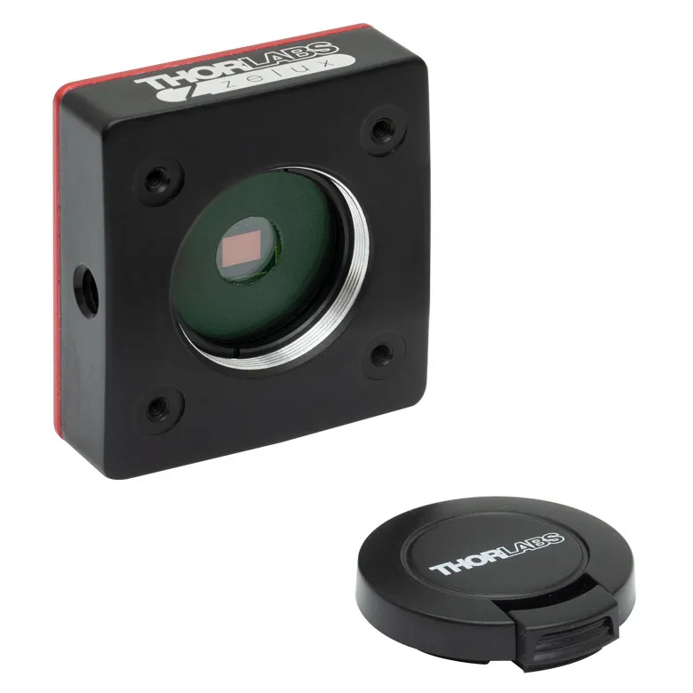
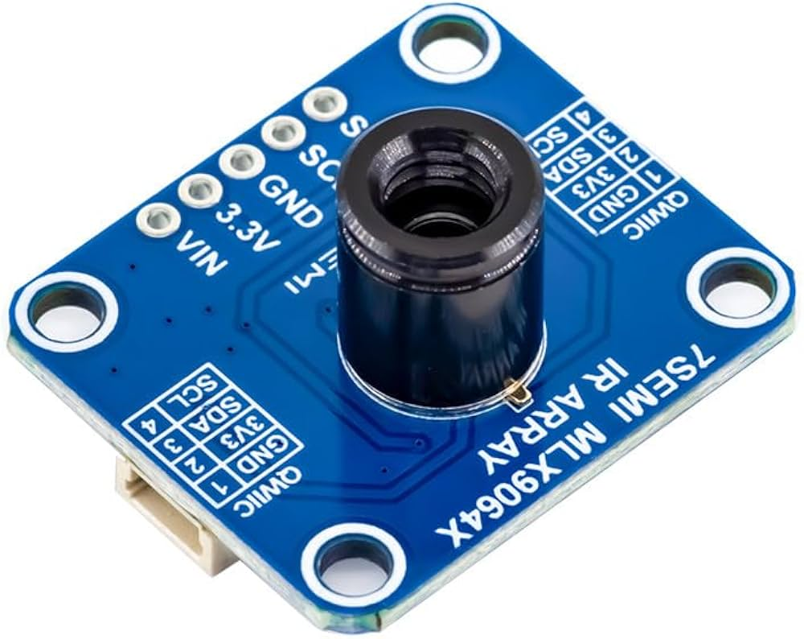

Behaviour video and surface-temperature measurements are recorded separately.

## Behaviour camera: Thorlabs CS165MU

We record under infrared illumination with a Thorlabs CS165MU, a 1.6 MP monochrome CMOS camera. [Specifications](https://www.thorlabs.com/item/CS165MU).

<figure markdown="1" style="border: 1px solid #d6d6d6; padding: 12px; margin: 24px 0; text-align: center;">

<figcaption>Thorlabs CS165MU behaviour camera.</figcaption>

</figure>

Lower-cost IR-sensitive cameras are suitable if nearby flies remain distinguishable across the full arena.

## Choosing a lower-cost camera

Assess full-resolution recordings of moving flies and close encounters, including at the arena edge.

| Requirement | What to check in a test video |
| --- | --- |
| Infrared sensitivity | The sensor, lens and any filters pass enough of the IR illumination |
| Resolution at the arena | Nearby bodies retain separate outlines where physically visible |
| Exposure and motion blur | Walking flies remain sharp rather than streaked |
| Frame timing | Movement can be followed between frames without recording gaps |
| Full-field focus | Both the centre and perimeter remain usable for tracking |
| Recording access | Original video can be saved with known timing and limited compression artefacts |

Review identities after complete overlaps, even with clear recordings.

## Position the behaviour camera

Mount the camera vertically above the arena, with the entire walking surface in view.

Focus across the centre and perimeter. Recalibrate after changing the lens, framing or camera position.

## Set up the thermal camera

The MLX90640 provides 32 × 24 surface-temperature estimates from emitted infrared radiation. [Sensor documentation](https://www.melexis.com/en/product/mlx90640/far-infrared-thermal-sensor-array).

<figure markdown="1" style="border: 1px solid #d6d6d6; padding: 12px; margin: 24px 0; text-align: center;">

<figcaption>MLX90640 thermal-camera board.</figcaption>

</figure>

An ESP32 reads the array over I²C and streams frames over USB. Its spatial resolution supports Peltier-plate and background measurements, not individual-fly tracking.

## Temperature recording

Record preheat, the full 300-second cooling interval and recovery for each Peltier plate, retaining timestamps and the A–D order.

Validate readings against a contact reference and retain raw data. The [camera sketch](../software/5-thermal-camera-stream.md) supplies a binary stream; computer-side recording is separate.
