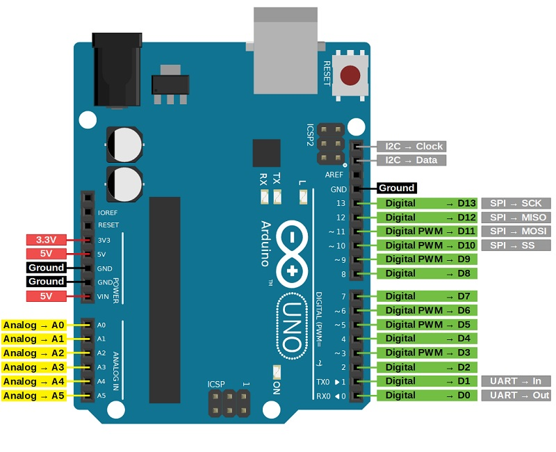

Pin maps for the Peltier-plate, display, background, ring and thermal-camera controllers.

## Controller assignments

| Label to put on the board | Program | Job |
| --- | --- | --- |
| Peltier-plate ESP32 | Experiment_Controller | Four Peltier plates and experiment timing |
| Display ESP32 | Display_Controller | The eight-panel panorama |
| Background Arduino | Closedloop_60peltier | One loop for the background of 60 Peltier modules |
| Ring Arduino | Thermal_ring | A separate temperature loop for the ring heater |
| Thermal-camera ESP32 | thermal_camera | Temperature images sent to the computer |

Background and ring pin maps refer to Arduino boards; confirm board-specific I²C pins.

ESP32 assignments refer to the classic ESP32, not the C3.

<figure markdown="1" style="border: 1px solid #d6d6d6; padding: 12px; margin: 24px 0; text-align: center;">

<figcaption>ESP32 development-board pinout.</figcaption>

</figure>

## Power and Peltier-plate connections

1. Disconnect supplies and label the Peltier plates using the [pin table](peltier-temperature-system.md#target-controller-pin-map).
2. Connect ESP32 PWM and enable pins to driver inputs.
3. Share controller and driver logic ground. Return load current directly to the supply.
4. Connect each Peltier plate across its driver's output pair, never to GPIO or ground.
5. Connect logic and load supplies to the correct terminals at the driver's rated voltage.
6. Test polarity on one channel under temperature monitoring before powering all four.

Follow the development board's power-input specification before combining USB and external power.

## Display board pin map

Display ESP32 assignments:

| HUB75 signal | ESP32 GPIO | What it carries |
| --- | --- | --- |
| R1 / G1 / B1 | 2 / 15 / 4 | Colour information for one row group |
| R2 / G2 / B2 | 16 / 27 / 17 | Colour information for the other row group |
| A / B / C / D / E | 5 / 18 / 19 / 21 / 12 | Row-address signals, as defined in the sketch |
| LAT / OE / CLK | 25 / 26 / 22 | Latch, output enable and clock |
| GND | Controller and panel signal ground | Shared signal reference |

Connect the ESP32 to panel 1 IN, then chain OUT → IN. Power panels separately. Use level conversion if required for 3.3 V control signals.

Run the [single-panel test](../software/6-single-panel-test.md), then restore the display sketch. ESP-NOW carries the selected A–D state.

## Background, ring and camera

### Supplied Arduino thermal controllers

| Circuit | Controller connection | Destination |
| --- | --- | --- |
| Background sensor | Board's SDA and SCL pins | TMP117 SDA and SCL |
| Background drive | Arduino pin 9 | PWM input of the correctly rated power stage |
| Background indicator | Arduino pin 13 | Indicator used by the sketch |
| Ring sensor | Arduino pin 2 | OneWire sensor data |
| Ring drive | Arduino pin 9 | Input of the ring MOSFET power stage |
| Each sensor | Compatible supply and GND | Sensor supply pins; follow its breakout documentation |

Pin 9 belongs to two separate boards; do not join these outputs. Use the OneWire sensor's specified pull-up resistor.

<figure markdown="1" style="border: 1px solid #d6d6d6; padding: 12px; margin: 24px 0; text-align: center;">

<figcaption>Arduino Uno pinout.</figcaption>

</figure>

Size the supply and power stage for all 60 Peltier modules in series. Peltier module and supply ratings are not specified here.

Match driver input logic levels and share signal ground for non-isolated stages. Keep load returns separate from signal wiring.

### Proposed ESP32 conversion

| Separate controller | Sensor pins | Proposed drive pin |
| --- | --- | --- |
| Background ESP32 | SDA 21 / SCL 22 | GPIO 25 |
| Ring ESP32 | OneWire data 4 | GPIO 25 |

These proposed assignments require changes to pin definitions and PWM code. **GPIO9 on ESP32-WROOM is used by flash memory** and cannot replace Arduino pin 9.

ESP32 sensor pull-ups and driver inputs must be compatible with 3.3 V logic.

### Thermal camera and other loads

Camera ESP32: GPIO21 → SDA, GPIO22 → SCL, compatible breakout supply and common ground. USB carries data. Fans and IR arrays use separate rated supplies.

## Check before connecting load power

With power off, check polarity, continuity and loose strands. Verify USB communication before enabling loads.

[ESP32 board power and pin reference](https://docs.espressif.com/projects/esp-dev-kits/en/latest/esp32/esp32-devkitc/user_guide.html) · [Install and upload](../software/install-and-upload.md)
