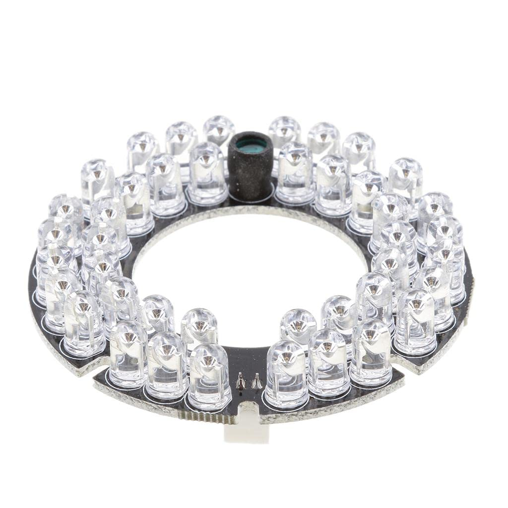

Four generic infrared LED arrays illuminate the arena. Each uses a printed shade, diffuser and PVC support.

[Generic IR arrays](https://www.amazon.in/Generic-Array-Infrared-Module-Camera/dp/B0DPKYDQDS) are suitable when matched to camera sensitivity and exposure.

<figure markdown="1" style="border: 1px solid #d6d6d6; padding: 12px; margin: 24px 0; text-align: center;">

<figcaption>Infrared LED array used for behaviour recording.</figcaption>

</figure>

## Illumination

Near-infrared illumination maintains camera visibility as the green panorama changes. It is separate from MLX90640 thermal imaging.

Check IR transmission through the camera's lens and filters.

## Printed shade and PVC stand

Printed shades hold the arrays and diffusers; PVC pipes set their height. Printed tubes can replace the pipes.

Secure each stand, allow heat dissipation and provide cable strain relief. Check diffuser transmission in the camera image.

[IR stand and lampshade CAD](../cad/parts-and-step-files.md#03-infrared-light-stand) · [Download the STEP model](../downloads/cad/ir-light-stand.step)

## Power and positioning

Use each IR array's rated voltage and polarity, with a supply sized for all four. Power arrays through their supply terminals.

Position lights around the arena for even coverage. Adjust angles to suppress reflections from the glass cover and carrier.

## Check before recording

| Check | What a suitable setup provides |
| --- | --- |
| Centre and edge | Flies remain distinguishable across the full arena |
| Nearby flies | Separate body boundaries are visible while flies approach each other |
| Movement | Exposure is short enough to avoid blurred fly outlines |
| Stability | No obvious brightness pulsing or changes during a trial |
| Reflections | No saturated patches that hide flies or resemble them in tracking |
| Heating | Lights and their mounts do not introduce unwanted arena warming |

Use fixed exposure and gain. Check moving flies and close encounters at full resolution before recording.

[Camera selection and recording](cameras.md) · [Tracking with AMADEUS](../analysis/tracking-with-amadeus.md)
