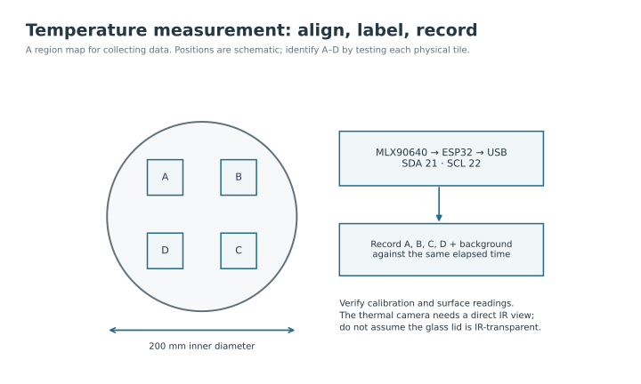

The behaviour camera records where the flies move. The thermal camera measures surface temperature. Their files answer different questions, and one cannot replace the other: a normal video does not show whether the cooling target reached its intended temperature.

## Position the behaviour camera

Mount the camera above the arena with the walking area centred in the image. Adjust the lens and height until the entire circular floor is visible, including its edge. Tighten the support only after confirming that the camera remains stable and that no mount blocks the view.

<figure class="photo-slot" data-photo-id="camera-view">

<figcaption>Photo · H06<strong>Camera and IR illumination</strong></figcaption></figure>

Focus at the walking surface, then inspect the centre and edge of the image. Keep the same camera position and lens settings across recordings that share a spatial calibration. Moving the camera changes the number of image pixels corresponding to a centimetre.

## Adjust illumination

Four infrared lights provide illumination for behaviour recording. Position them so flies remain visible across the floor and reflections from the lid or metal do not obscure the image. Change one light position at a time and inspect the camera image after each change. Keep supports and cables out of the camera view.

Use the supply specified on the illumination hardware. LED-panel power and IR-light power are different circuits. Record the final exposure and illumination arrangement with the experiment so a second person can reproduce the imaging conditions.

## Calibrate distance and time

Measure the inner arena diameter in a frame and divide that pixel diameter by **20 cm** to obtain pixels per centimetre. Measure the walking-area boundary rather than the outer ring. An angled view can distort the circle, so correct the camera alignment before relying on a single scale factor.

Check the actual recorded frame rate and timestamps. Do not assume a video exported from another program has the same timing as the original. Keep the original recording and note the frame or time at which the first cooling step begins; the experiment controller's preheat is not the first cooling trial.

## Set up the thermal camera

The MLX90640 returns a **32 × 24 grid of temperature values**. Its ESP32 forwards those values over USB. It needs a direct infrared view of the measured surface; verify any window material instead of assuming that the arena's glass cover is suitable.

Use repeatable regions over A, B, C and D and over representative background areas. Identify the target letters by testing each physical tile. The positions in the diagram are schematic. Keep regions away from boundaries where a measurement may combine a target and its surroundings.

## Record enough to interpret a trial

Record temperatures before cooling, during the full 300-second interval and after switching away from the target. Keep the elapsed time and target order with the temperature file. A single minimum temperature cannot show whether a tile stayed cool throughout the trial or whether the arena background warmed over repeated trials.

Check thermal readings against an independent contact reference at suitable accessible locations. Store the unprocessed data as well as plots. The [camera program](../firmware/camera.md) describes the binary stream; it is not a ready-made video or a complete computer-side recorder.
