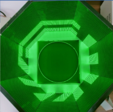
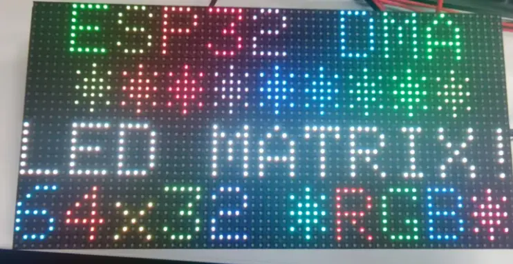
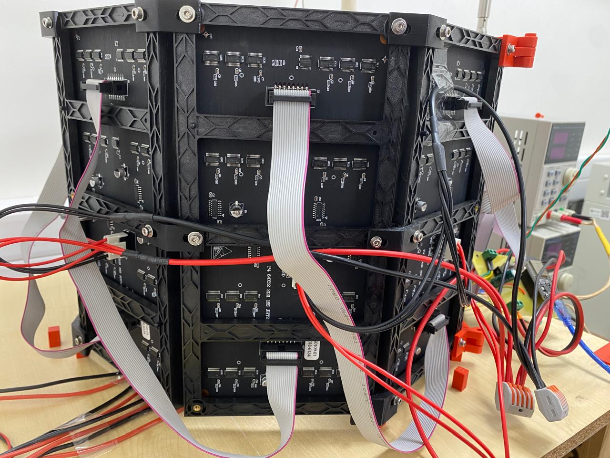
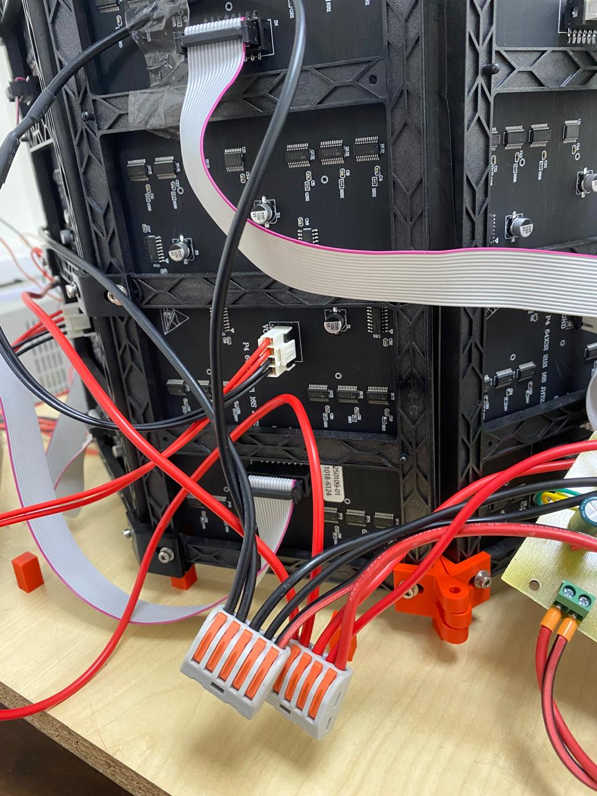

Eight Waveshare P4 RGB panels surround the arena in an octagon. Each panel has 64 × 32 pixels at 4 mm spacing and measures 256 × 128 mm. The panels face inward and show green bars on a black background.

<figure markdown="1" style="border: 1px solid #d6d6d6; padding: 12px; margin: 24px 0; text-align: center;">

<figcaption>LED panorama around the arena.</figcaption>

</figure>

## Assembly

Centre the octagon around the arena and leave one panel hinged for access. Connect each HUB75 OUT connector to the next panel's IN. Use an external 5 V supply for panel power and a common signal ground with the ESP32.

<figure markdown="1" style="border: 1px solid #d6d6d6; padding: 12px; margin: 24px 0; text-align: center;">

<figcaption>Waveshare 64 × 32 P4 RGB panel.</figcaption>

</figure>

<figure markdown="1" style="border: 1px solid #d6d6d6; padding: 12px; margin: 24px 0; text-align: center;">

<figcaption>Rear view of the eight-panel display and HUB75 connections.</figcaption>

</figure>

<figure markdown="1" style="border: 1px solid #d6d6d6; padding: 12px; margin: 24px 0; text-align: center;">

<figcaption>Panel power and ribbon-cable connections.</figcaption>

</figure>

## Visual pattern

The panorama combines horizontal, vertical and diagonal bars. Their apparent width depends on the distance from the fly to the panels. At 160 mm, an 11-pixel bar is 44 mm wide and subtends about 15.7° when viewed straight on from its centre.

[Wiring](esp32-and-arduino-wiring.md#display-board-pin-map) · [Display program](../software/2-secondary-esp32-the-led-display-controller.md)
