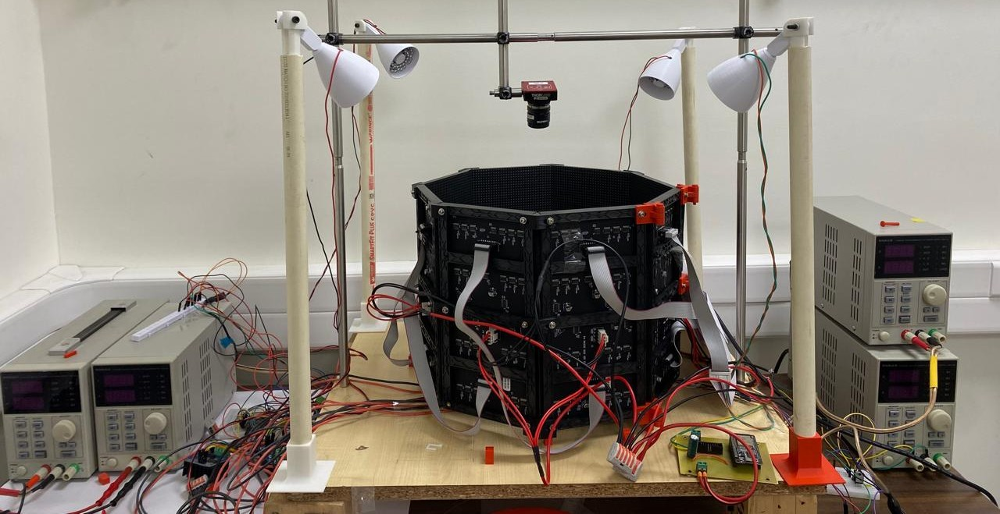

<figure markdown="1" style="border: 1px solid #d6d6d6; padding: 12px; margin: 24px 0; text-align: center;">

<figcaption>Visual Place Learning Arena.</figcaption>

</figure>

The apparatus combines a heated walking arena, four cooling Peltier plates, an LED panorama and overhead video recording.

## Experimental setup

One Peltier plate cools during each trial while the other three heat. The Peltier-plate ESP32 synchronises the selected position with the visual panorama; the background and ring run independent temperature-control loops.

## Assembly

| Component | Assembly checks |
| --- | --- |
| [Arena](arena-and-dimensions.md) | Level floor, secure supports, sealed Peltier-plate edges |
| [Wiring](esp32-and-arduino-wiring.md) | Board labels, pin assignments, supply ratings |
| [Peltier temperature system](peltier-temperature-system.md) | Background feedback, A–D mapping and temperature response |
| [LED display](led-display.md) | Panel order, orientation, bar dimensions |
| [Thermal ring and glass cover](thermal-ring-and-glass-cover.md) | Fit, clearance, camera view |
| [Illumination](illumination.md) | Uniformity, mounting, reflections |
| [Cameras](cameras.md) | Focus, calibration, timing |

## Configuration

Pin maps and timings match the published sketches. Supply ratings and fabrication tolerances depend on the installed components.

[Equipment list](equipment-and-materials.md) · [Software setup](../software/install-and-upload.md) · [CAD parts](../cad/parts-and-step-files.md)
