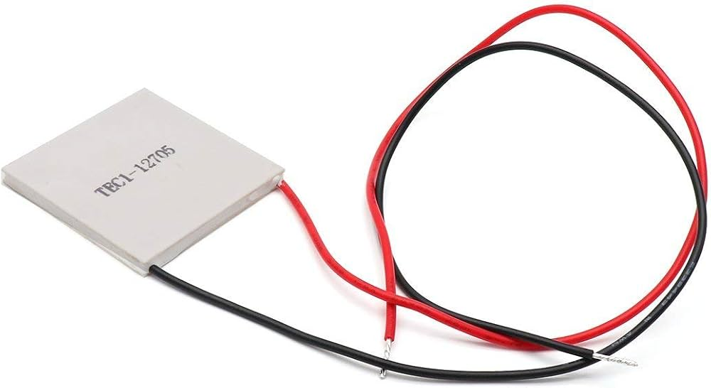
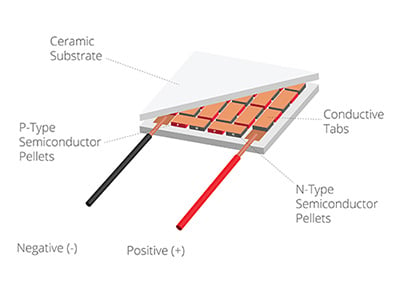

The arena uses 60 Peltier modules for the background and four independently driven Peltier plates at positions A–D. The background uses temperature feedback. The four Peltier plates follow timed PWM commands.

<figure markdown="1" style="border: 1px solid #d6d6d6; padding: 12px; margin: 24px 0; text-align: center;">



<figcaption>Peltier module.</figcaption>

</figure>

## Background of 60 Peltier modules

The 60 Peltier modules form one series circuit with a single power-control output. An Arduino reads a TMP117 sensor over I²C and drives the external power stage from pin 9.

Peltier current direction determines heat-flow direction. The achieved surface temperature depends on current, thermal contact and heat dissipation. Verify polarity and temperature on the assembled arena.

<figure markdown="1" style="border: 1px solid #d6d6d6; padding: 12px; margin: 24px 0; text-align: center;">



<figcaption>Internal structure of a Peltier module.</figcaption>

</figure>


### Set the background temperature

Open the background Arduino in Serial Monitor at 115200 baud with a newline ending. Set the required sensor temperature with:

```text
SET 34.8
```

The controller replies with the accepted temperature. Send `STATUS` to check the sensor reading, setpoint and PWM output. The command is not stored after a restart; the firmware then returns to its 34.8 °C default.

This command changes the temperature used by the feedback loop. The TMP117 records only its own location, so confirm the arena surface temperature independently.

Defaults: 34.8 °C, 150/255 maximum PWM, 100 ms sensor interval, and PID gains 60 / 4 / 5.

## Four cooling Peltier plates

One ESP32 drives four BTS7960 bridges. LPWM heats each Peltier plate and RPWM cools it. The opposite output is zeroed before reversal.

### Peltier-plate controller pin map {#target-controller-pin-map}

| Peltier plate | Manual number | Driver channel | RPWM | LPWM | R_EN | L_EN |
| --- | --- | --- | --- | --- | --- | --- |
| A | 1 | 3 | 27 | 14 | 23 | 22 |
| B | 2 | 2 | 25 | 26 | 13 | 15 |
| C | 3 | 4 | 19 | 18 | 2 | 16 |
| D | 4 | 1 | 32 | 33 | 4 | 5 |

The outputs use 20 kHz, 8-bit PWM. Connect each Peltier plate across its driver output and verify the installed polarity under temperature monitoring.


Wire with power disconnected using the [connection guide](esp32-and-arduino-wiring.md#power-and-peltier-plate-connections). Label both ends of each cable A–D and retain these labels in the video and analysis.


### Trial sequence {#trial-sequence}

The Peltier-plate controller heats all four Peltier plates for five minutes before the first trial. During each 300-second trial, one Peltier plate cools while the other three heat.

| Stage | Output |
| --- | --- |
| Initial cooling | PWM 150 for 23 s |
| Remaining 277 s | PWM 106 on first selection; 120 on a repeat |
| Preheat | Heating at PWM 30 for 300 s |
| Peltier plates not yet cooled | Heating at PWM 29 |
| Peltier plates previously cooled | Heating at PWM 24 |
| Return to heating | PWM 50 for 17 s, then 24 |


These are programmed outputs rather than measured temperatures. The selected Peltier plate should reach **23–25 °C**; confirm this from recorded surface temperatures.

## Temperature change across 10–11 trials

Record the background and Peltier-plate temperatures throughout a 10- or 11-trial run, including preheat. Check whether the background warms as the four plates operate, and adjust the background `SET` temperature in a later run if needed. Keep the same glass-cover position and airflow. Add trial-by-trial temperature plots here when available.

[Background controller](../software/3-60-peltier-background.md) · [Four-Peltier controller](../software/1-primary-esp32-the-four-peltier-controller.md) · [Operating procedure](../software/how-to-run-an-experiment.md) · [Thermal imaging](cameras.md#set-up-the-thermal-camera)
