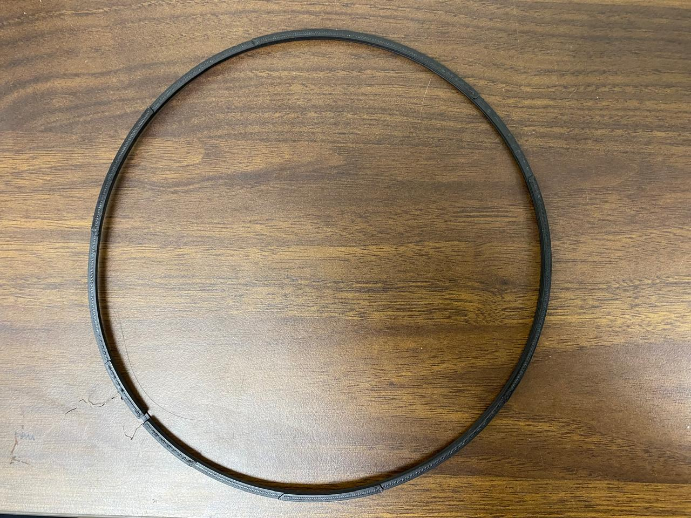
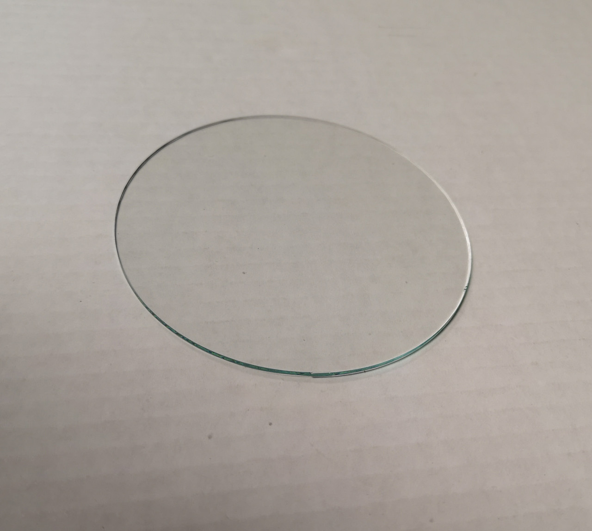

The perimeter heater has its own temperature sensor and controller, independent of the floor and four Peltier plates.

## Control

<figure markdown="1" style="border: 1px solid #d6d6d6; padding: 12px; margin: 24px 0; text-align: center;">

<figcaption>Thermal ring.</figcaption>

</figure>

An Arduino regulates heater PWM through a MOSFET using OneWire temperature feedback.

## Wire and mount the ring

1. Pass Cu Wire through the thermal ring through the dedicated holes
2. Attach a DS18B20 sensor on the sides of the thermal ring in reliable thermal contact for closed loo
4. Connect sensor data to Arduino pin 2 and MOSFET control to pin 9. See [wiring](esp32-and-arduino-wiring.md#background-ring-and-camera).
5. Verify readings against an thermocouple contact based temperature sensor during warm-up.

## Setpoint and cutoff

Setpoint: 45 °C at the sensor. Heating stops above 57 °C and can resume after cooling. The cutoff is software-based and is not permanent.

## Glass cover

The glass cover is ideally 2–3 mm thick and around 9 inches in diameter. Inexpensive annealed glass works well enough.

<figure markdown="1" style="border: 1px solid #d6d6d6; padding: 12px; margin: 24px 0; text-align: center;">

<figcaption>Round annealed-glass cover.</figcaption>

</figure>
