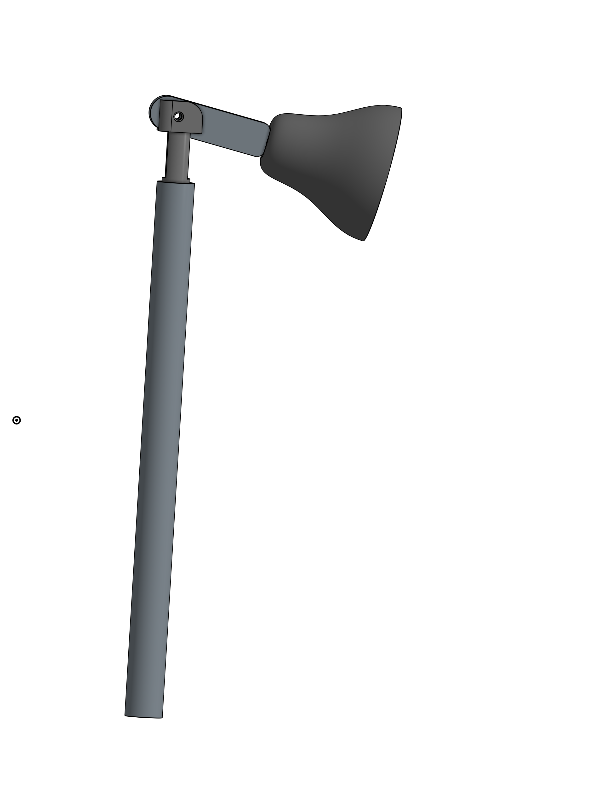

How does a fly use its surroundings to find a remembered location? We study this question with a heated walking arena, a cool target and a surrounding visual display.

Our work adapts an established behavioural assay using standard Peltier modules, LED matrix panels, ESP32 and Arduino boards, and parts made in the makerspace. This site documents the apparatus and the analysis needed to turn recorded movement into measurements of target finding.

[Explore the apparatus](hardware/index.md){: .home-link } [Follow the analysis](analysis/index.md){: .home-link }

<figure class="home-figure arena-photo"><figcaption>The arena inside the eight-panel visual display.</figcaption></figure>

<strong>20 cm</strong> walking arena<strong>4</strong> selectable targets<strong>8</strong> LED panels<strong>Individual</strong> fly trajectories

## From visual cues to spatial memory

Finding a cool patch once can happen by chance. Visual place learning asks whether a fly learns where that patch lies relative to surrounding landmarks, then uses that relationship to guide its search.

The original study linked this behaviour to the **ellipsoid body**, a structure within the fly brain's central complex. Silencing particular groups of its ring neurons impaired place learning while leaving several sensory and motor abilities intact. The mushroom-body manipulations tested did not produce the same deficit. This points to a specific circuit requirement for the task. [1](#reference)

## The experiment behind this build

Ofstad, Zuker and Reiser trained flies to find a cool tile in a warm arena. Between trials, the target and visual panorama moved together, preserving their spatial relationship. Flies found the target more quickly and by shorter routes across training. Darkness and uncoupled visual cues weakened learning. In a subsequent probe trial, cooling was removed: trained flies still searched preferentially where the visual scene predicted the target. [1](#reference)

This distinction matters when interpreting our recordings. Arrival time measures target finding; evidence for visual memory also depends on the cue relationship and appropriate control conditions.

## A makerspace approach to the apparatus

The aim is to make the assay practical to build, repair and adapt with accessible parts. Custom fabrication is concentrated in the supports and fittings that hold the components together.

**Temperature.** Sixty Peltier modules form the heated background. Four separately driven tiles provide the selectable targets. Cooling transfers heat to the underside, so the design includes space for a fan and provision for heat removal beneath the tiles.

**Visual environment.** Eight standard 64 × 32 LED panels form an octagon. Printed legs set their position, and a hinged panel provides access to the arena.

**Control and fabrication.** ESP32 and Arduino boards handle the display, timing and thermal circuits. A wooden base provides structural support; PVC pipe and printed lampshades carry the infrared lights. Editable CAD files allow these fittings to be reproduced or adjusted locally.

These choices reduce dependence on custom instruments. The camera, power supplies and temperature measurements remain important parts of the setup: affordability still depends on stable illumination, reliable tracking and verified thermal conditions.

<figure class="home-figure"><figcaption>Infrared-light support: pipe, printed fittings and a lampshade.</figcaption></figure>

## What we measure

An overhead camera records the flies under infrared illumination. AMADEUS provides individual tracks; the arena analysis GUI aligns those tracks with the video and the four target regions.

The analysis follows target-reaching time, paths, distance travelled, speed and occupancy across trials. In the current GUI, a fly reaches the target after remaining inside its region for three continuous seconds; movement within that region is allowed. Reviewing trajectories alongside the video helps identify tracking errors before comparing behaviour.

<figure class="home-figure analysis-photo"><figcaption>The analysis interface links each fly's movement to the target selected for that trial.</figcaption></figure>

## Build and analysis documentation

[**01 · HARDWARE** Arena construction, thermal control, wiring, visual display and imaging.](hardware/index.md)

[**02 · SOFTWARE** Controller programs, installation, operating procedures and checks.](firmware/index.md)

[**03 · ANALYSIS** AMADEUS tracking, target registration and behavioural measurements.](analysis/index.md)

[**04 · CAD** Editable STEP files and the role of each fabricated part.](cad/index.md)

<strong>1 · Reference</strong> Ofstad, T. A., Zuker, C. S. &amp; Reiser, M. B. <em>Visual place learning in Drosophila melanogaster.</em> Nature 474, 204–207 (2011). <a href="https://doi.org/10.1038/nature10131">doi:10.1038/nature10131</a> · <a href="https://pmc.ncbi.nlm.nih.gov/articles/PMC3169673/">Full text</a>

