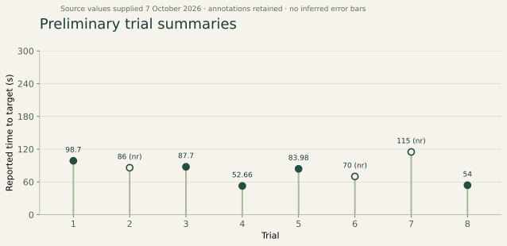

## What is available

An eight-trial time-to-target series was supplied in the project notes on **7 October 2026**. The later revision of those values is reproduced here as a preliminary record. The associated per-fly table, replicate structure, averaging rule, and final reviewed tracking data have not been established for this series.

!!! warning "Descriptive record only"
    These numbers are not a validated population learning curve. Three values carry an `nr` annotation in the source notes. Until that annotation is tied to the underlying fly-level data, they must not be interpreted as complete-cohort success means.

*Reported values only; no fitted learning trend or invented uncertainty. Hollow markers retain the source `nr` flags. The 300 s axis is the planned trial duration.*

| Trial | Reported time (s) | Annotation retained from source |
| --- | --- | --- |
| 1 | 98.70 | — |
| 2 | 86.00 | `nr` |
| 3 | 87.70 | — |
| 4 | 52.66 | — |
| 5 | 83.98 | — |
| 6 | 70.00 | `nr` |
| 7 | 115.00 | `nr` |
| 8 | 54.00 | — |

[Download the transcribed values as CSV](../downloads/preliminary_trial_times.csv). The CSV preserves the supplied annotations and does not fill trials 9 or 10.

## What can be said now

The supplied times vary across trials. They do not show a monotonic decrease. Without knowing precisely which flies contribute to each value and how the `nr` trials were summarized, a fitted trend or percent improvement would risk combining unlike outcomes.

An earlier nine-fly example reported path length, speed, and time-moving values during pipeline development. Those values came from a different context and are not pooled with this later ten-fly record.

## What is needed for a research result

Link the trial summaries to their raw recording, tracking file, analysis version, calibration, start frame, target boxes, and included population. Resolve all `nr` annotations and report each individual's outcome, plus coverage and missing data. Review identity continuity and obtain replicate sessions with appropriate comparison conditions before making an inferential claim.

For publication, show individual trajectories and latency distributions alongside aggregate estimates; report the experimental unit, number of sessions, number of animals, and handling of censored events. Confidence intervals or error bars require their actual underlying sample information.

See the [metric definitions](../methods/analysis.md) and [scientific rationale](rationale.md).
