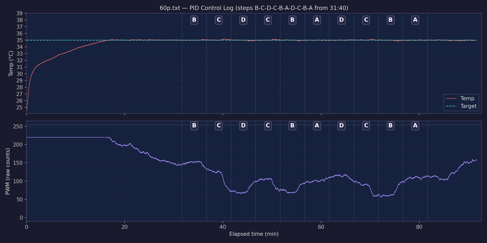

The 60-Peltier background is checked with a thermal camera and temperature sensors placed at several positions inside the arena. The thermal image shows spatial uniformity, while the sensors confirm that the temperature remains within the accepted range throughout an experiment.

A control sensor regulates PWM through a PID loop and logic-level MOSFET. Performance can change with room temperature, Peltier module condition, thermal paste, the aluminium plate, and whether the four cooling Peltier plates use the same heat sink or a separate one.

<figure markdown="1" style="border: 1px solid #d6d6d6; padding: 12px; margin: 24px 0; text-align: center;">

<video controls muted loop style="max-width: 100%;">
  <source src="../images/THermalcamera_exp-video.mp4" type="video/x-msvideo">
</video>

<figcaption>Thermal-camera recording of temperature uniformity across the 60-Peltier background.</figcaption>

</figure>

<figure markdown="1" style="border: 1px solid #d6d6d6; padding: 12px; margin: 24px 0; text-align: center;">

<figcaption>Background temperature and PWM during an experiment.</figcaption>

</figure>

<figure markdown="1" style="border: 1px solid #d6d6d6; padding: 12px; margin: 24px 0; text-align: center;">

<figcaption>Temperatures measured at several positions inside the arena.</figcaption>

</figure>
