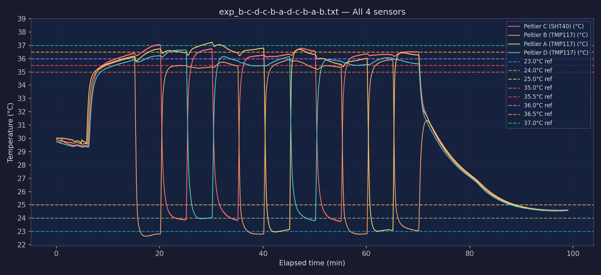

Sensors on Peltier plates A–D record temperature throughout the experiment. The combined traces show whether each plate reaches the required temperature quickly enough during repeated heating and cooling cycles and remains within the accepted bounds.

<figure markdown="1" style="border: 1px solid #d6d6d6; padding: 12px; margin: 24px 0; text-align: center;">

<figcaption>Temperatures of the four cooling Peltier plates during one experiment.</figcaption>

</figure>
